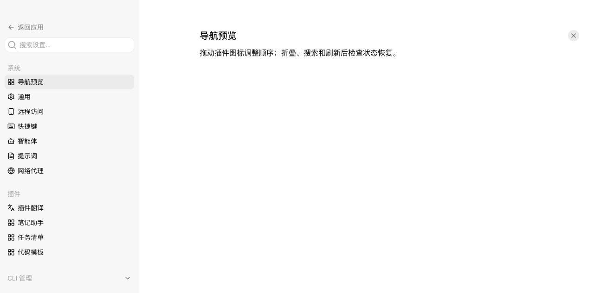
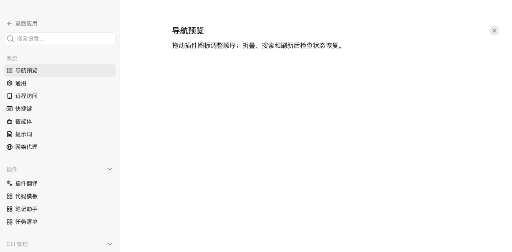
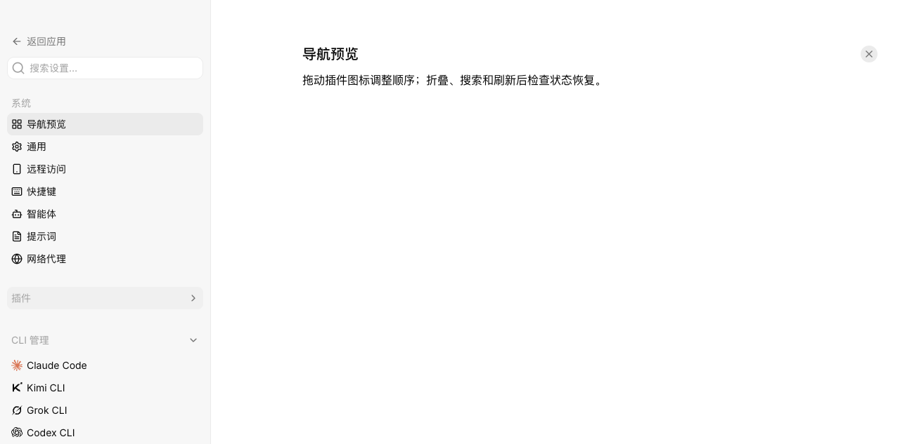

# 设置页插件导航测试报告

- 日期：2026-11-23
- 关联需求：https://github.com/zhukunpenglinyutong/desktop-cc-gui/issues/1534
- 基线：上游 `v1.2.6`，提交 `f4e3845b1`。
- 范围：仅设置页 `plugins` 分组的排序、折叠、独立持久化及搜索交互；侧栏和其他分组保持原行为。此 PR 只实现该 issue 的设置页部分，不关闭整个 issue。

## 执行环境

macOS / Darwin arm64，Node.js 26.12.0，pnpm 10.29.3，Vitest 3.2.4；浏览器验证使用本机 Chromium、Vite 预览及真实设置页组件。示例插件和原生 IPC 替身不访问用户数据，浏览器源的 localStorage 与原生应用数据隔离。

## 命令与结果

| 检查 | 结果 | 通过率 |
| --- | --- | --- |
| 相关回归：`pnpm exec vitest run src/features/settings/SettingsPage.test.tsx src/components/application/settings/settings-shell.test.tsx src/lib/cli-nav-order.test.ts` | 3 个文件、26 项通过，0 失败、0 跳过 | 100% |
| `pnpm build` | 类型检查及生产构建通过；存在 CSS 兼容性和包体积告警 | 通过 |
| `pnpm test` 中的 Node 测试 | 52 项通过，0 失败、0 跳过 | 100% |
| `pnpm test` 中的全量 Vitest | 2821 项通过、5 项失败、11 项跳过；316 个文件通过、2 个失败、2 个跳过；另有 1 个异步异常 | 已执行用例 99.82% |
| 未修改的上游副本中复验失败相关的三个文件 | 同样 5 项失败、15 项通过，0 跳过 | 用于确认基线问题，不作为本功能验收通过率 |
| `git diff --check` | 通过 | 通过 |

全量 Vitest 的通过率以 2821 / (2821 + 5) 计算，跳过项不计入分母；不能将全量结果表述为全部通过。

## 功能回归

| 场景 | 验证方式与结果 |
| --- | --- |
| 默认展开及箭头位置 | 组件测试通过；浏览器确认尾随箭头与默认展开 |
| 插件启停、新增入口 | 注册、注销、重新注册条目；新条目追加；禁用期间重排后原条目重新启用的位置保留；测试通过 |
| 排序保存与恢复 | 排序提交回调写入完整 section key；卸载重建后恢复；浏览器真实图标拖动后刷新，恢复重排顺序 |
| 折叠保存与恢复 | 测试验证卸载重建；浏览器折叠后刷新仍折叠 |
| 搜索态 | 浏览器及组件测试确认匹配分组展开、无拖拽手柄；搜索时点标题不覆盖保存值，清空搜索后恢复折叠态 |
| 未移动手柄后取消 | 指针按下、取消并等待 150ms；顺序及展开态不变，测试通过 |
| 高度动画与窄屏 | 浏览器逐帧采样展开高度得到 18 个不同值（0–128px），确认非瞬间切换；390px 宽度下保留横向静态入口，无折叠标题和拖拽手柄 |
| 可访问性与误触 | 复用独立的图标手柄和页面按钮；无嵌套按钮；折叠区域复用 `inert` 和 `aria-hidden` |
| CLI 与其他非插件分组 | 既有 CLI 分桶、折叠、深链接、系统和能力扩展测试通过；CLI 排序存储未被插件排序覆盖 |
| 侧栏与条目不一致 | 侧栏实现无修改；设置页使用两个专用存储键，不读取侧栏排序或折叠状态 |

状态键：`ccgui-next.settingsPluginsNavOrder:v1`、`ccgui-next.settingsPluginsNavExpanded:v1`。

## 基线缺陷与限制

1. 上下文缓存的异常存储测试失败：测试对存储原型设置的替身未拦截当前环境使用的存储对象。
2. 文本引用验收的四个场景失败：读取调用实际带有第二个可选参数 `undefined`，既有断言仅期望一个参数。
3. 全量运行在 Worktree 删除对话框测试环境销毁后记录了 `location is not defined`；堆栈来自传输层重连定时器。该异常在上述三个文件的上游集中复验中没有重现，因此其归因尚未最终确认。
4. 两组外部插件冒烟测试共 11 项因缺少旁侧插件仓库而按既有规则跳过。
5. 根据本次范围要求，不修改上述无关代码或测试，不放宽断言、不关闭失败检查。
6. 浏览器使用真实 React 组件与示例数据；重新挂载和刷新恢复不等同于原生应用退出重启实测。产生拖拽预览后再取消回滚尚未完成真实交互验证。
7. 测试存在异步 `act` 和运行时存储警告；构建告警不导致检查失败。

## 界面证据

同一示例页面在上游代码与当前代码中分别截图；预览页面可通过 `/tests/browser/settings-plugin-nav.html` 重放。

### 修改前

### 修改后：展开并重排

### 修改后：折叠

## 终审结论

本功能代码终审无阻断问题，相关 26 项回归全部通过，构建通过；全量测试存在已复现的上游基线失败及上述异步异常。提交保留完整结果和验证边界，未声称全量通过。侧栏功能及行首箭头不在本次实现范围。
